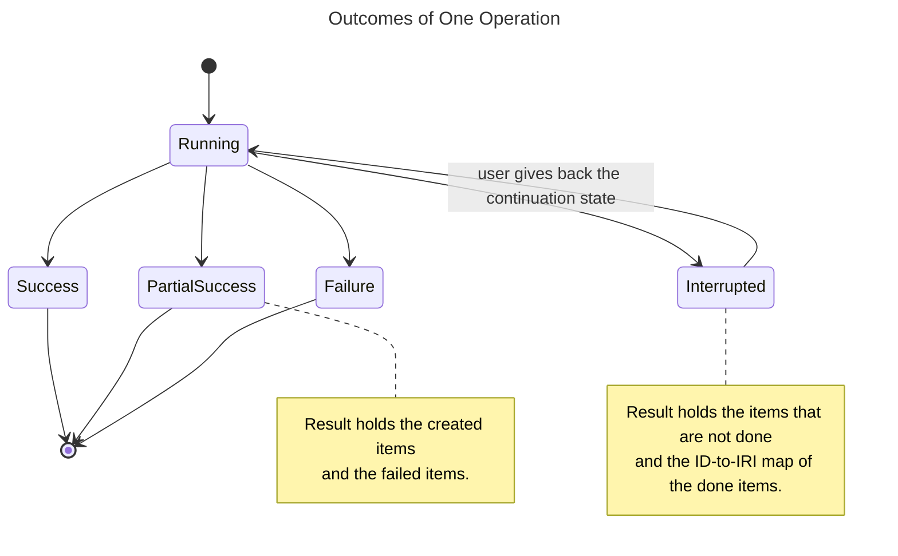
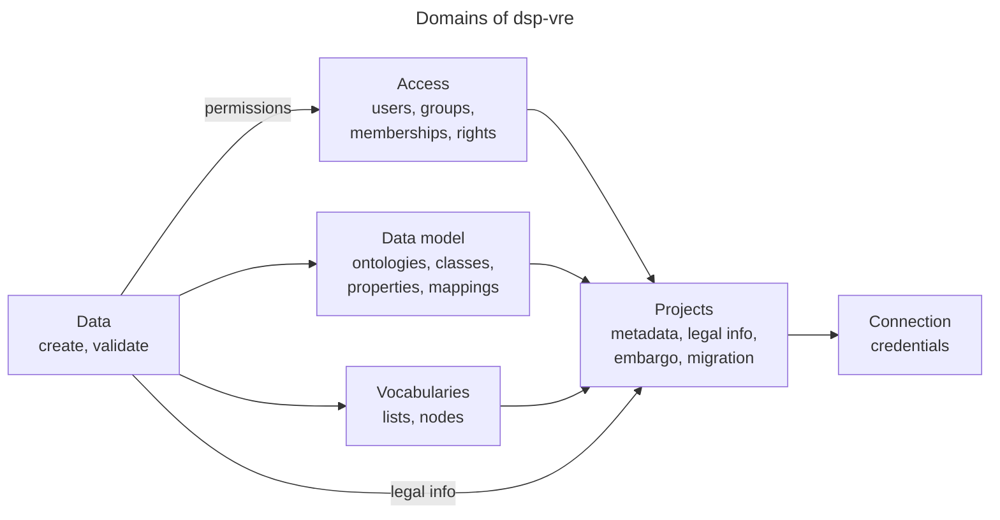

# ADR for the Python Package `dsp-vre`

## Summary

`dsp-vre` is a Python package for the DSP server.
DaSCH tools, DaSCH services and external researchers use it for all server interaction.
This ADR records the public interface of `dsp-vre`: principles, package name, result model and domains.
The internals are out of scope.

## Context

Today, the server clients live in `src/dsp_tools/clients/`, and only `dsp-tools` uses them.
Other DaSCH services and researchers need the same server access, but they cannot use these clients.
The clients also show API concepts (routes, JSON-LD, the separate ingest service) to the caller.

The package has two user groups:

- DaSCH tools and services, which use the package for all server interaction.
- External researchers, who use the package in scripts and notebooks.

## Decision

### Principles

1. **Intent over procedure.**
   The user states the result, for example "create this data".
   The package decides the order, the batching and the retries.
   The user does not know that resources with circular links need two steps.
2. **No API concepts.**
   Routes, JSON-LD, API versions and the separate ingest service are not visible.
   The user sees one DSP server.
3. **Python objects in and out.**
   Input and output are typed, immutable dataclasses.
   File formats (JSON, XML, Excel) are not part of the package.
4. **Local references.**
   The user refers to items by their own ID, name or shortcode.
   The package returns the server IRIs as part of the result.
5. **One item or many.**
   Each operation accepts one item or a collection.
6. **Results, not exceptions per item.**
   A bulk operation returns a result with the created items and the failures.
7. **Same verbs in every domain.**
   Each domain has create, read, update and delete.
   Domain actions add to these verbs where necessary.
    - Create is only for new items. Create of an item that exists fails.
    - Update changes or adds to an item that exists.
    - Delete is possible for all items. On Data, delete marks an item as deleted and does not erase it.
8. **Long operations can continue.**
   An interrupted bulk operation returns a state that the user gives back to continue.
9. **Full permission model.**
   The interface shows the full permission model, not only pre-sets.
10. **Rights are known before an operation.**
    A helper function returns an enum of the operations that the current user can do.
    As a result, a client can check the rights before it starts an operation.
11. **Functional error model.**
    The package does not raise errors.
    Typed objects show the outcome of an operation: success, partial success or failure.
    Python has no native type for this, thus the package uses enums.

### Package Name

The PyPI name is `dsp-vre`. The import name is `dsp_vre`.

### Synchronous Interface Only

The package has a synchronous interface only. The reasons are:

- Researchers use scripts and notebooks.
  Notebooks run their own event loop, thus an asynchronous interface is difficult to use there.
- Speed comes from parallel work inside the package (principle 1), not from the interface.
- An asynchronous interface can come later as a separate module, if a user needs it.

### Result Model

Each operation returns a result object and does not raise an error (principles 6, 8 and 11).
The outcome of the result is an enum value.
The diagram shows the outcomes of one operation.

### Domains

The package has six domains.
The diagram shows which domain needs which other domain. An arrow points to the domain that is needed.
All domains need Connection through Projects.

Each domain lists the capabilities in scope for the first release.
"Future work" lists the capabilities for later releases.

#### Connection

- Connect to a server with credentials.

Future work: none at this time.

#### Projects

- Project with metadata.
- Legal info: licenses, copyright holders, default authorship.
- Embargo state of the project.
  The first release mocks the embargo: the code ignores the set permissions.
  This changes when the server implements the embargo.
- Migration: export a project from one server and import it into another server.
  The export includes the data model and the admin data.

Future work:

- Embargo: mark a project as under embargo, and lift the embargo in the database.

#### Access

- Users, groups and memberships.
- Operations that the current user can do (principle 10).

#### Data Model

- Ontologies, classes, properties, cardinalities and access restrictions.
- External mappings of classes and properties.

#### Vocabularies

- Lists and nodes.

Future work:

- Reorder nodes.
- Change labels and comments of nodes.

#### Data

- Create data: resources, values and files as one unit.
  The package selects the ingest strategy.
- Validate data against the data model on the server.
  The validation includes files and existing data.
  The validation runs in the package and does not change the server.

Future work:

- Add values to existing resources.
- Replace existing values and files.
- Change permissions of resources and values without versioning of the data.
- Export data as Python objects, for example by class.

## Consequences

Positive:

- DaSCH tools, DaSCH services and researchers use one server interface.
- API changes on the server affect `dsp-vre` only, not its callers.
- File formats stay in `dsp-tools`. `dsp-vre` stays free of JSON, XML and Excel parsing.

Negative:

- `dsp-tools` and `dsp-vre` have two release cycles.
- `dsp-tools` depends on a pinned version range of `dsp-vre`.
- A synchronous interface can be too slow for callers that need many parallel operations.

## Open Decisions

### Progress & Reporting

Status: not decided.

The options are:

- **Callback.**
  The user gives an optional function to a long operation, for example `on_progress`.
  The package calls the function after each item with one progress event:
  items done, items total, current item, and failures so far.
- **Standard logging.**
  The package writes to a Python logger with the fixed name `dsp_vre`.
  The caller configures handlers, formats and files.
  Levels: `INFO` for start, end and summary of an operation, `DEBUG` for each item, `WARNING` for failed items.
- **Continuation state.**
  An interrupted bulk operation returns a dataclass with the items that are not done,
  and the ID-to-IRI map of the items that are done.
  The package gives functions to save the state to a file and to read it from a file.
  The user gives the state back to the same operation, which does not create done items again.
- **Server-side streaming (long term).**
  A streaming service on the server keeps the state, thus the state never reaches the client.
  This option needs an asynchronous design.

The options get evaluated against one real bulk-create use case before a decision.

## Related Documents

- [Map: `dsp-vre` domains in `dsp-tools`](dsp-vre-to-tools-map.md):
  which `dsp-tools` command uses which domain, with the `dsp-tools create` worked example.
- [Set-up for the split](dsp-tools-split-package-setup.md):
  repository layout, dependency direction and release timeline.
